# video-inspect · AI Agent Skill

<p align="center">
  
</p>

A skill for **OpenCode**, **Claude Code**, **Kilo CLI**, and other terminal AI agents that lets vision-capable models **"watch" local video files** — `.mp4`, `.mov`, `.mkv`, `.webm`, etc.

Models reject binary input (`read` fails on videos), so this skill bridges the gap by converting a video into inputs every multimodal model already understands:

- **Sampled JPEG frames** — evenly spaced or timestamp-targeted screenshots
- **Optional audio transcript** — extracted via `whisper` (if installed)

## Install

### OpenCode
**Linux / macOS**:
```bash
git clone https://github.com/Arynz-C/video-inspect.git "$HOME/.config/opencode/skills/video-inspect"
chmod +x "$HOME/.config/opencode/skills/video-inspect/scripts/video-inspect.sh"
```

**Windows (PowerShell)**:
```powershell
git clone https://github.com/Arynz-C/video-inspect.git "$HOME\.config\opencode\skills\video-inspect"
```

### Claude Code / Kilo CLI / Other AI Agents
Clone repo ke direktori skills agent atau folder kerja:
```bash
git clone https://github.com/Arynz-C/video-inspect.git
```

## Requirements

- AI Agent pendukung skills/multimodal vision (**OpenCode**, **Claude Code**, **Kilo CLI**, dll)
- `ffmpeg` dan `ffprobe` di PATH:
  - **Linux (Ubuntu/Debian)**: `sudo apt install ffmpeg jq`
  - **Linux (Arch)**: `sudo pacman -S ffmpeg jq`
  - **Windows**: `scoop install ffmpeg` / `winget install Gyan.FFmpeg`
- (opsional) `whisper` untuk ekstraksi transkrip audio

## Cara Penggunaan

1. **Buka CLI Agent pilihan** (OpenCode / Claude Code / Kilo CLI).

2. **Add Skill atau Pilih Skill**:
   - Di OpenCode prompt:
     ```text
     add skill https://github.com/Arynz-C/video-inspect
     ```
   - Atau ketik `/skills` lalu pilih `video-inspect`.

3. **Tanya / Kirim Prompt ke Agent**:
   ```text
   > @video-inspect Downloads/video.mp4 cari pergerakannya
   > @video-inspect "baca video di ./clip.mp4 dan jelaskan isinya"
   ```

Skill akan otomatis mengekstrak sampel frame JPEG via FFmpeg, menyinkronkan audio via Whisper, lalu memberikan konteks visual berurutan ke model agar bisa menjawab dengan **sitasi timestamp** presisi.

## Options

| Flag | Description |
|------|-------------|
| `-Frames <n>` | number of evenly spaced frames (default 8) |
| `-MaxWidth <px>` | downscale frames (default 768) |
| `-Timestamps 0,1.5,3` | extract exact timestamps instead of even spacing |
| `-Transcript` | also transcribe audio with `whisper` |
| `-OutDir <dir>` | output folder (default `%TEMP%\video-inspect\<name>-<ts>`) |

## Limits

- Sampled frames only — very fast motion / brief flashes can be missed (raise `-Frames`).
- Audio understanding requires `whisper`; non-English audio needs a multilingual model.

## Author

**Arynz** ([@Arynz-C](https://github.com/Arynz-C)) — Anarchist of the False Network.
